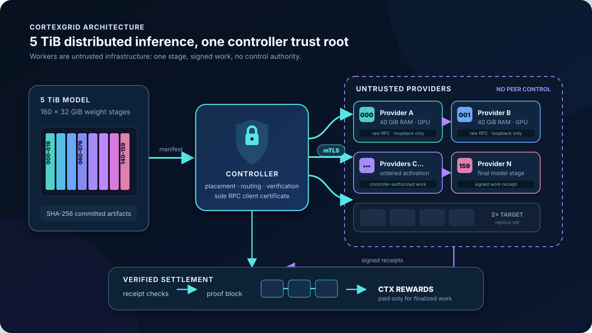

# CortexGrid

CortexGrid is a devnet for distributed AI inference with a native utility
token. Python coordinates inference and consensus; llama.cpp runs model layers
on native C++/CUDA participants.



The included SmolLM2 135M Q4_K_M model is split across two private RPC
participants. Each stage has three candidate replicas, so an unavailable node
can be replaced. Successful participants sign Ed25519 attestations, which are
committed to a Merkle root and verified before the inference fee, burn,
issuance, and worker rewards are finalized in an append-only CTX block.

## Run a coordinator

Requirements: Python 3.11+, CMake 3.20+, a C++20 compiler, OpenSSL development
headers, and Python `cryptography`. CUDA and an NVIDIA GPU are optional.

```bash
make bootstrap-model
make run-real
```

Open <http://localhost:4173>.

## Plan a 5 TiB model

The capacity profile describes exactly 5 TiB of weights as 160 ordered 32 GiB
stages. Each placement reserves 40 GiB for weights plus runtime overhead:
160 compatible providers and 6.25 TiB aggregate RAM make one complete route;
320 providers and 12.5 TiB make the target two-copy layout.

```bash
make run-5tb
curl http://localhost:4173/api/models/capacity | python3 -m json.tool
```

New providers are assigned the least-replicated compatible stage. The signed
assignment includes its layer range, exact byte size, artifact URL, SHA-256
commitment, and RAM floor. Readiness remains false while any stage is missing.
This built-in profile validates placement, routing, and capacity logistics; it
does not bundle or pretend to execute an unpublished 5 TiB checkpoint
(`artifactsAvailable` is `false`).

## Use the network with CortexTerm

End users do not need a wallet or CTX. CortexTerm submits ordinary chat
requests; the network gateway sponsors admission while verified compute
providers receive CTX in the finalized inference block.

From a CortexGrid checkout, start an interactive conversation:

```bash
./CortexTerm --server http://COORDINATOR_IP:4173
```

Useful interactive commands are `/status`, `/route`, `/proof`, `/new`, `/help`,
and `/exit`. Conversation context remains local to that CortexTerm session.

Run one prompt non-interactively:

```bash
./CortexTerm --server http://COORDINATOR_IP:4173 \
  -p "Explain distributed inference in one sentence."
```

For scripts, use JSON output:

```bash
./CortexTerm --server http://COORDINATOR_IP:4173 \
  --json -p "Summarize pipeline parallelism."
```

Each result identifies the selected provider route, proof root, finalized
block, gateway fee, and worker reward.

## Join the inference network

Run the coordinator on one server:

```bash
make bootstrap-model
make run-real
```

On a provider server, build only the native worker and llama.cpp RPC backend:

```bash
make bootstrap-provider
make join \
  NODE_ID=my-gpu-01 \
  NODE_NAME="My GPU" \
  REGION=us-east \
  MEMORY_GIB=24 \
  PROVIDER_PRICE_MICRO=10 \
  COORDINATOR_URL=http://COORDINATOR_IP:4173 \
  COORDINATOR_PUBLIC_KEY=OUT_OF_BAND_KEY \
  ADVERTISE_HOST=PROVIDER_IP
```

The provider opens its signed control API on port `51800` and a TLS 1.3 model
RPC endpoint on `50052`. Both must be reachable from the coordinator. The raw
llama.cpp socket binds only to provider loopback. Its external mTLS tunnel
requires the controller CA and the exact pinned controller client certificate;
the controller also pins each provider certificate. Other providers and
ordinary Internet clients cannot invoke tensor RPC. Obtain the coordinator
public key out of band and pass it as `COORDINATOR_PUBLIC_KEY` on the first
start; secure RPC refuses trust-on-first-use. The provider then verifies and
pins the signed RPC trust bundle and stage assignment.

Registration returns a coordinator-signed assignment containing the model
version, stage number, layer range, memory requirement, and weight commitment.
It is saved to `.provider/NODE_ID/assignment.json`. On the first selected route,
llama.cpp streams that stage's tensors into provider RAM/VRAM; later requests
reuse the resident buffers. Its RPC cache can also persist sufficiently large
tensors. The daemon heartbeats automatically and re-registers after a
coordinator restart.

`make join` runs the provider in the foreground. From another terminal on that
provider, inspect and operate it:

```bash
./CortexNode status     --node-id my-gpu-01
./CortexNode jobs       --node-id my-gpu-01
./CortexNode balance    --node-id my-gpu-01
./CortexNode assignment --node-id my-gpu-01
./CortexNode watch      --node-id my-gpu-01
./CortexNode leave      --node-id my-gpu-01
./CortexNode join       --node-id my-gpu-01
```

`CortexNode` talks to the provider-local operations API. It shows RPC health,
heartbeat state, CTX address and balance, assigned model/stage/layers, active
jobs, and recent finalized jobs with their block, proof, and reward. Join and
leave require the operator token stored with mode `0600` under
`.provider/NODE_ID/operator_token`; the private node key is never exposed.
`leave` removes the node from routing while keeping the daemon running so
`join` can make it available again. Stop the daemon with `Ctrl-C`.

A provider is paid only when selected for finalized inference and its Ed25519
receipt verifies.

### Provider wallet custody

CTX balances live on the chain under the reward address shown by
`./CortexNode balance`. The private key controlling that address is stored
locally at `.provider/NODE_ID/node_wallet.json` with mode `0600`; back it up
offline and never share it. Losing the key loses control of that balance.

The devnet validates signed address-to-address transfers through
`POST /api/transfers`, but does not yet expose a safe `CortexNode transfer`
workflow. CTX is not listed on an exchange and currently cannot be converted to
USD.

## Inspect the whole network

```bash
curl http://COORDINATOR_IP:4173/api/health       # coordinator and chain health
curl http://COORDINATOR_IP:4173/api/network      # aggregate capacity and activity
curl http://COORDINATOR_IP:4173/api/nodes        # every provider and assignment
curl http://COORDINATOR_IP:4173/api/models       # model stages and replicas
curl http://COORDINATOR_IP:4173/api/models/capacity # RAM needs and missing stages
curl http://COORDINATOR_IP:4173/api/chain        # supply, balances, and blocks
curl http://COORDINATOR_IP:4173/api/economics    # rates and current emission epoch
curl http://COORDINATOR_IP:4173/api/blocks/1     # one block with full receipts
```

Add `| python3 -m json.tool` to pretty-print any response. The browser dashboard
at `http://COORDINATOR_IP:4173` shows the same live network data.

## CTX economics

End users remain wallet-free. The gateway pays a metered CTX service fee based
on model compute, prompt tokens, generated tokens, and the selected providers'
signed price quotes. Of each fee, 85% goes to providers, 10% to the protocol,
and 5% is burned.

New issuance is an early-network subsidy, not a fixed reward. A declining
per-epoch budget is unlocked by ready assigned capacity and paid inference
demand, is capped at 20% of provider fees, and is distributed only to providers
that completed verified work. Idle capacity receives no CTX. Inspect the live
policy and epoch budget with:

```bash
curl http://localhost:4173/api/economics
```

See [CTX economics](docs/ECONOMICS.md) for the exact deterministic formula.

## Verify

```bash
make test
make test-real
```

The real-model suite verifies two-node generation, equality with a
deterministic one-node reference, valid CTX settlement, replica failover, and a
remote provider carrying real tensor traffic through controller-only mTLS.
The build uses CUDA automatically when `nvcc` is available and otherwise uses
llama.cpp's CPU backend.

Pinned artifacts:

- llama.cpp commit: `720d7fa4097f76e5d0eade5a92c1df87c1faf9d9`
- Model: `SmolLM2-135M-Instruct-Q4_K_M.gguf`
- Model SHA-256:
  `2e8040ceae7815abe0dcb3540b9995eaa1fa0d2ca9e797d0a635ae4433c68c2d`

## Current boundary

Remote providers can join, but this remains a devnet. Registration, assignments,
readiness, heartbeats, and work tickets are signed. Tensor RPC is encrypted with
TLS 1.3 and mutually authenticated so only the controller identity reaches a
provider's loopback llama.cpp backend. The JSON control API is still HTTP; use
an HTTPS reverse proxy or VPN when metadata confidentiality matters. Worker
signatures prove participation and make token settlement auditable; they do not
yet prove every numerical operation. Production still needs certificate
rotation/revocation, replicated correctness checks, and Byzantine block
finality.

CTX has protocol utility, but utility cannot guarantee market price or monetary
value. A public launch requires independent security, economic, and legal
review. See [the architecture notes](docs/ARCHITECTURE.md) and
[worker protocol](docs/PROTOCOL.md) for details.
