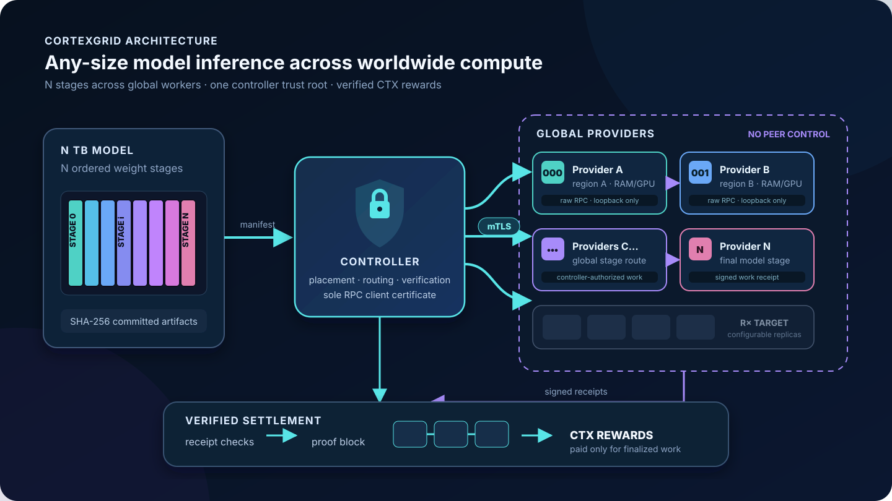

# CortexGrid

> **CortexGrid pools compute from participants worldwide so the network can
> support AI models of any size—models no participant could run alone.**
> As worldwide RAM, VRAM, and compute grow, the network can host more model
> stages, add replicas, and serve more inference. Every machine that completes
> verified inference work earns CTX.

CortexGrid uses a simple centralized coordinator: Python assigns model stages,
routes inference, verifies work, and finalizes the CTX ledger. C++/CUDA and
llama.cpp perform model execution on participant hardware.



An arbitrary-size model is divided into `N` ordered stages sized for available
provider capacity. Those stages can be placed across machines and regions
worldwide. Providers host signed assignments without gaining control
authority; the controller remains the trust root for placement, RPC access,
verification, and CTX settlement.

## Start the network

Requirements: Python 3.11+, CMake 3.20+, a C++20 compiler, OpenSSL development
headers, and Python `cryptography`. CUDA is optional.

```bash
make bootstrap-model
make run-real
```

Open [http://localhost:65534](http://localhost:65534). The dashboard shows live
network capacity and inference activity, then guides a new machine through
joining CortexGrid. `COORDINATOR_PUBLIC_KEY` is the `coordinatorPublicKey`
reported by `/api/health`; confirm it through a trusted channel before joining
a remote network.

## Join, chat, and earn CTX

This mode opens CortexGrid Chat while also offering the machine's compute to
the network:

```bash
make bootstrap-provider
make chat-browser \
  COORDINATOR_URL=http://COORDINATOR_IP:65534 \
  COORDINATOR_PUBLIC_KEY=OUT_OF_BAND_KEY \
  ADVERTISE_HOST=THIS_MACHINE_IP \
  TERM_MEMORY_GIB=24
```

The command creates a local provider identity and reward wallet, receives a
model stage, starts the local compute bridge, and opens the browser. No CTX or
pre-existing wallet is required: the service gateway sponsors the inference
payment. Your machine receives its provider payment when selected. Closing the
process leaves the network.

For the terminal interface:

```bash
make chat \
  COORDINATOR_URL=http://COORDINATOR_IP:65534 \
  COORDINATOR_PUBLIC_KEY=OUT_OF_BAND_KEY \
  ADVERTISE_HOST=THIS_MACHINE_IP \
  TERM_MEMORY_GIB=24
```

Useful commands are `/status`, `/route`, `/proof`, `/new`, `/help`, and
`/exit`. `/status` shows the hosted stage and current CTX balance.

## Join as a dedicated worker

A dedicated worker serves inference without opening a chat client:

```bash
make bootstrap-provider
make join \
  NODE_ID=my-gpu-01 \
  NODE_NAME="My GPU" \
  MEMORY_GIB=24 \
  PROVIDER_PRICE_MICRO=10 \
  REGION=us-east \
  COORDINATOR_URL=http://COORDINATOR_IP:65534 \
  COORDINATOR_PUBLIC_KEY=OUT_OF_BAND_KEY \
  ADVERTISE_HOST=THIS_MACHINE_IP
```

Operate it from another terminal:

```bash
./CortexNode status     --node-id my-gpu-01
./CortexNode jobs       --node-id my-gpu-01
./CortexNode balance    --node-id my-gpu-01
./CortexNode assignment --node-id my-gpu-01
./CortexNode leave      --node-id my-gpu-01
./CortexNode join       --node-id my-gpu-01
```

## Model placement

The model manifest divides weights into ordered layer stages. When a machine
registers its available memory and compute, the coordinator assigns a stage
that fits. The signed assignment identifies the model version, layer range,
memory requirement, and weights digest. llama.cpp transfers those tensors into
the provider's RAM or VRAM and reuses its local cache.

Inference runs through one provider for each ordered stage, wherever that
provider is located. Aggregate memory determines how large a model the network
can place; replicas, compute, and network capacity determine throughput and
fault tolerance.

## CTX

CTX is the settlement asset for inference. End users can remain walletless:
the service gateway pays CTX on their behalf, while subscriptions or other
user billing remain outside the ledger.

```text
provider quote   = verified work units × provider service rate
service payment = provider quotes ÷ 95%
provider reward = provider quote + declining bootstrap issuance
```

Providers receive 95% of the gateway service payment; the coordinator receives
5%. Early-network issuance starts as a 2× match on provider service revenue and
halves every one million finalized inferences. The match is clipped at the
1 billion CTX supply cap, but paid service revenue continues after issuance
ends. There is no burn.

Every selected provider signs a work receipt. The coordinator verifies the
route, model commitments, output commitments, signatures, pricing, and
settlement before finalizing a block. Idle, offline, invalid, and unselected
machines earn nothing. Providers should set `PROVIDER_PRICE_MICRO` high enough
to cover their own hardware, electricity, bandwidth, and operating costs;
lower-priced replicas are routed first.

Balances are stored on the CTX ledger. The key controlling a worker's address
stays in `.provider/NODE_ID/node_wallet.json`; the default chat identity uses
`.provider/cortexterm/node_wallet.json` for compatibility.

Network APIs:

```bash
curl http://COORDINATOR_IP:65534/api/network
curl http://COORDINATOR_IP:65534/api/models
curl http://COORDINATOR_IP:65534/api/chain
curl http://COORDINATOR_IP:65534/api/economics
```

See [CTX economics](docs/ECONOMICS.md) and the
[protocol](docs/PROTOCOL.md) for ledger and proof details.

## Verify

```bash
make test
make test-real
```

The included real-model demo uses SmolLM2 135M. The manifest and placement
architecture can describe much larger models, but the devnet is not yet a
production-scale multi-terabyte deployment. Registration, assignments, work
tickets, and receipts are signed. The upstream llama.cpp tensor RPC must still
run on a trusted private network or VPN. Work signatures prove attributable
participation, not Byzantine-safe numerical correctness. CTX has no guaranteed
market value or exchange listing, and a configured provider rate is not a
profit guarantee.
